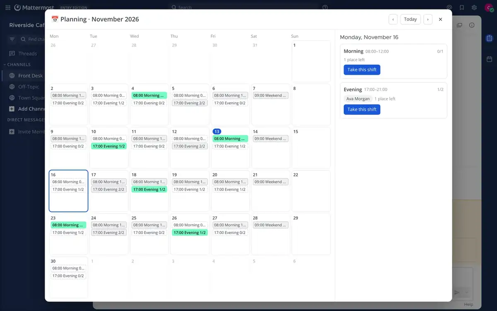
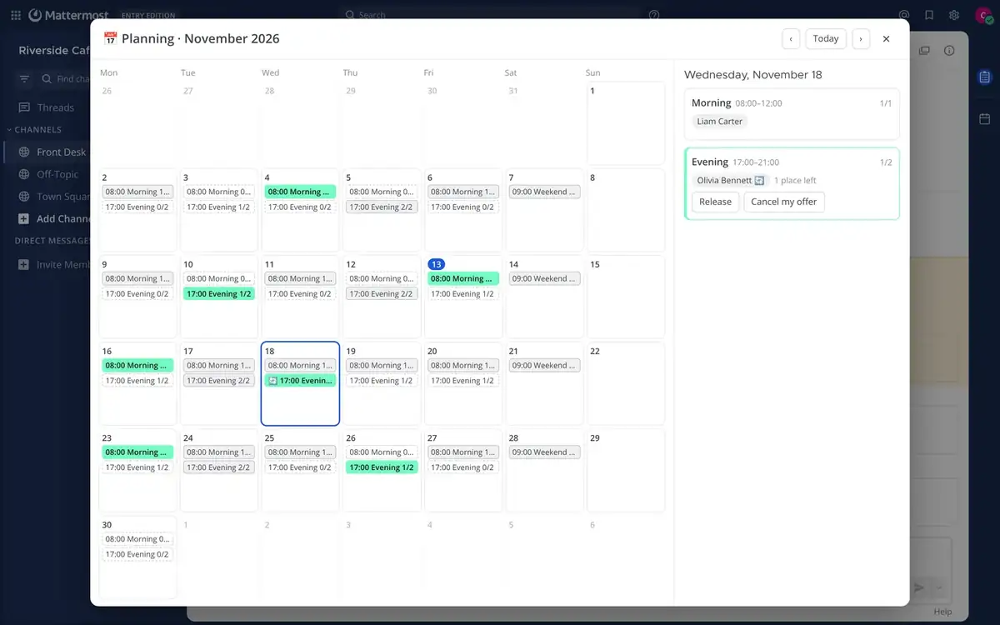
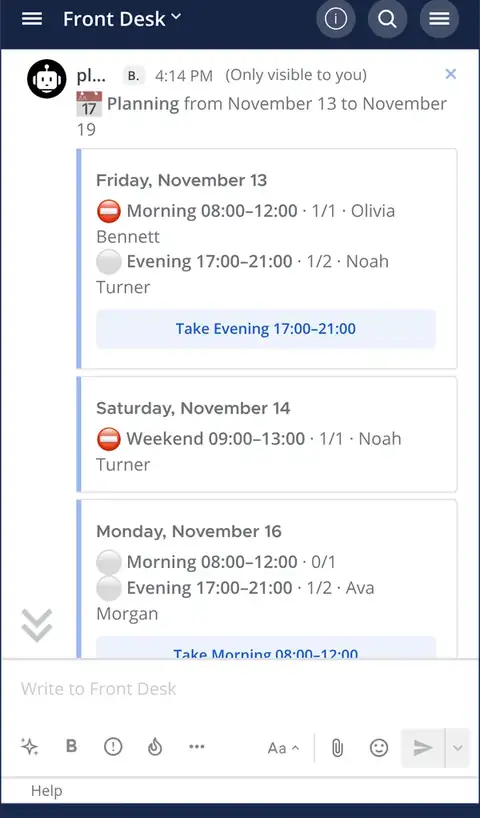
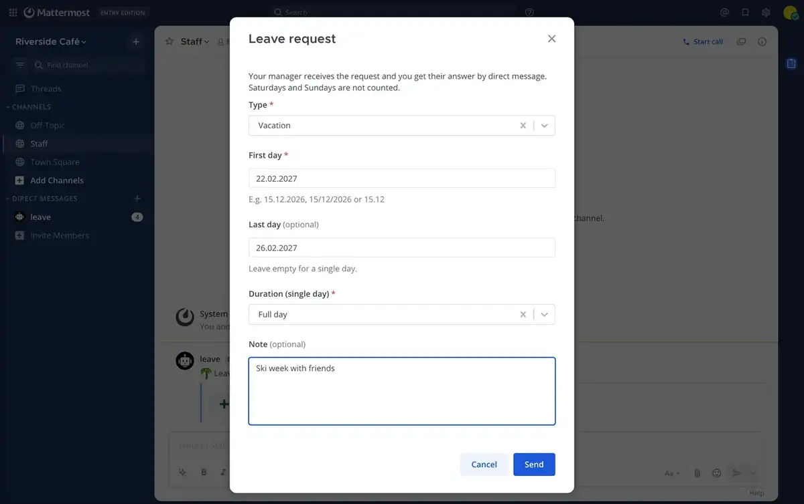
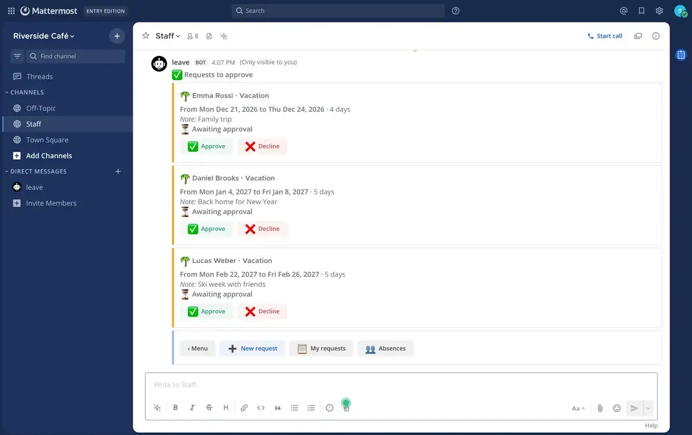
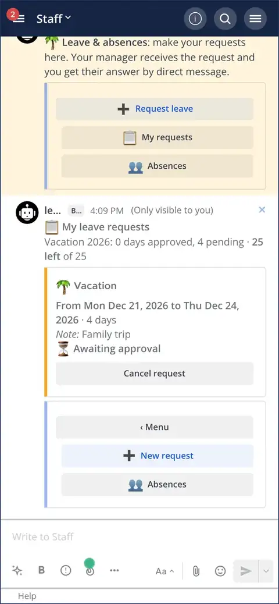
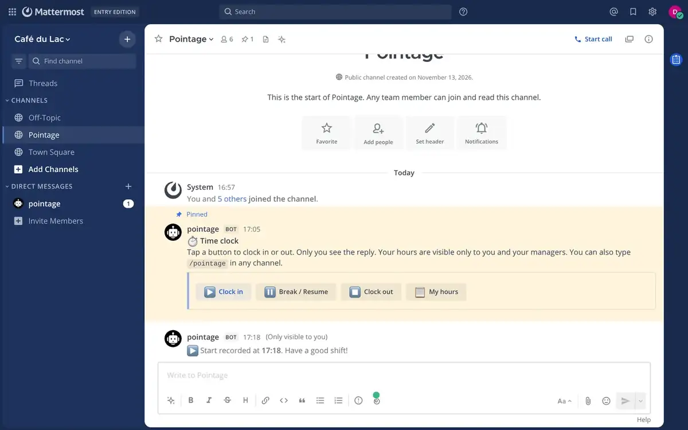
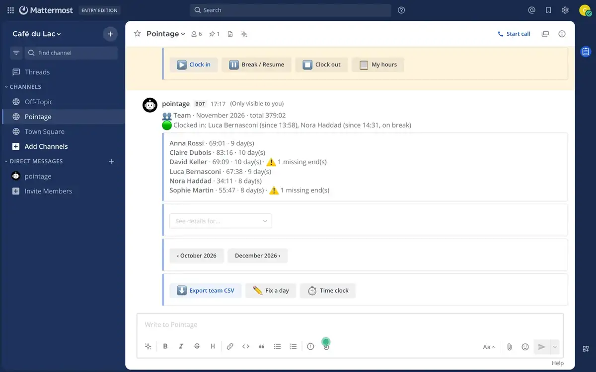
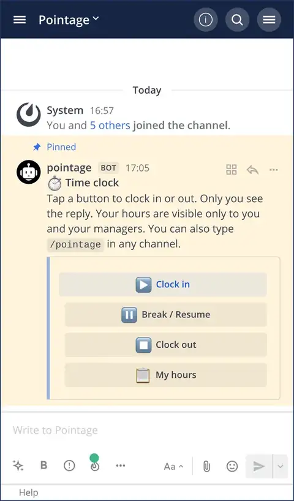

# ShiftPlugins

Shift planning, leave requests and a time clock for Mattermost. Built for teams that work in shifts: cafés, shops, care homes, rescue services. Works on desktop and in the iOS and Android apps, in English, French, German and Italian.

**Free and open source (MIT).** Download the ready-to-install packages from **[shiftplugins.com](https://shiftplugins.com)**, where you can pay what you want: $0 is fine, or $5 a plugin and $12 for all 3. Why 5? Well, just to pay for a coffee or two.

This repository holds the full source code, docs, screenshots and issue tracker.

This repository holds the full source code, docs, screenshots and issue tracker.

| Plugin | What it does | Command | Plugin ID |
| --- | --- | --- | --- |
| [Planning](#planning) | Monthly shift calendar per channel, take/release shifts, swaps with optional approval | `/planning` | `com.shiftplugins.planning` |
| [Leave requests](#leave-requests) | Time-off requests, approve in one tap, who's away, yearly allowance | `/leave` (`/conges`, `/ferien`, `/ferie`) | `com.shiftplugins.leave` |
| [Time clock](#time-clock) | Clock in/out from pinned buttons, breaks, manager fixes, CSV export | `/pointage` | `com.shiftplugins.timeclock` |

## Planning



- Monthly calendar per channel, off by default, on with one click
- Several shifts per day with hours and number of places (1 to 10)
- Repeat shifts daily, on weekdays or weekly until a date
- Members take or release a shift; admins lock a shift or the whole month
- Shift swaps: offer your shift, a colleague takes it, optional admin approval
- Mobile app: `/planning` lists the next 7 days with Take and Release buttons
- The bot posts each change in the channel and pins an "Open planning" button

<p>
  
  
</p>

## Leave requests



- `/leave` opens a form: type, dates, half day, note
- Managers get a direct message with Approve and Decline (with a reason)
- The requester gets the answer by direct message
- "My requests" to cancel, "Absences" shows who's away for the next 6 weeks
- Custom leave types (defaults: Vacation and Sick); weekends aren't counted
- Optional yearly allowance with days left per person
- Pinned button for one-tap access in the mobile app

<p>
  
  
</p>

## Time clock



- Pinned buttons: Clock in, Break / Resume, Clock out, My hours
- Same actions with `/pointage` commands
- Reminder when someone forgets to clock out; they can enter the real end time
- Managers see, fix and export everyone's hours; night shifts handled
- People get a direct message about every correction
- CSV export (one line per period, total per person) that opens in Excel

<p>
  
  
</p>

## Install

See [docs/install.md](docs/install.md). In short: enable plugin uploads, upload the `.tar.gz` in System Console → Plugins → Plugin Management, then enable it.

## Build from source

Each plugin lives in [`plugins/`](plugins): `planning`, `leave` and `timeclock`. You need Go (the version in each `server/go.mod`). The Planning webapp is plain JavaScript with no build step.

```sh
cd plugins/planning
./build.sh   # vets, tests, builds linux amd64 + arm64, writes com.shiftplugins.planning-<version>.tar.gz
```

## Compatibility

| | |
| --- | --- |
| Mattermost | 10.0 or newer, tested on 11.7 |
| Editions | Team, Entry, Professional, Enterprise |
| Clients | Web, desktop app, iOS and Android apps |
| Languages | English, French, German and Italian, following each user's Mattermost language |
| Hosting | Self-hosted servers (Mattermost Cloud workspaces can't upload plugins) |
| Server | Linux amd64 and arm64 |

## FAQ

**Is it really free?** Yes. Every plugin and every update is free. Paying on the website is optional and works like a tip.

**Can I change the code?** Yes. It's MIT licensed: use it, change it, ship it. Just keep the copyright notice.

**Where is the data stored?** In your own Mattermost database, through the plugin key-value store. Nothing leaves your server, and your normal backups cover it.

**Refunds?** If you paid and it doesn't work on your server, email within 14 days and you get your money back.

## License

[MIT](LICENSE). Copyright (c) 2026 Smafe.

## Support

Open an [issue](../../issues) or email michael@smafe.ch.

---

Developed in Switzerland by [Smafe](https://smafe.ch). Plugins for Mattermost; not affiliated with or endorsed by Mattermost, Inc. Mattermost is a trademark of Mattermost, Inc.
